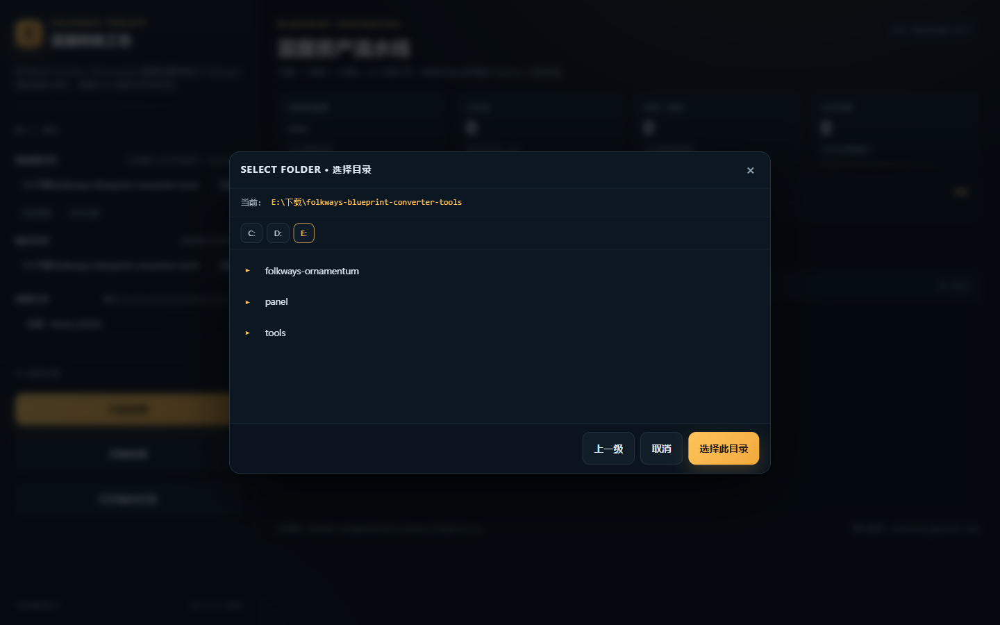

# folkways_ornamentum


**Language:** [English](#english) · [中文](#中文)


Unofficial **Folkways × Domum Ornamentum × Materials Integration** compatibility work for Minecraft 1.21.1 / NeoForge.


> **Download:** [v1.0.0 Release](https://github.com/Zhougon-12/folkways-do-materials_integration/releases/tag/v1.0.0) · **Showcase:** [zhougon-12.github.io/folkways-do-materials_integration](https://zhougon-12.github.io/folkways-do-materials_integration/) · **Promo:** [48s video](https://github.com/Zhougon-12/folkways-do-materials_integration/releases/download/v1.0.0/folkways-domum-promo-48s.mp4)


---


## English


### Overview


This repository collects the addon source, core patches, blueprint conversion tools, Chinese/English names, and in-game test evidence produced while integrating **Sword & Kingdom** building packs into [Folkways](https://github.com/IzakyL/folkways).


### Upstream credit


- [Folkways](https://github.com/IzakyL/folkways) — the colony mod this addon targets. The `core-patch/` source is derived from Folkways nightly `86e1068`; its MIT license and copyright belong to IzakyL.

- [Domum Ornamentum](https://github.com/ldtteam/Domum-Ornamentum) — material-textured building blocks.

- Materials Integration by 22angle — resource unification.

- Sword & Kingdom building-pack authors and translators — blueprint and language sources.


### Features


- Converts MineColonies/Structurize `.blueprint` packs into native Folkways structure NBT.

- Preserves Do `textureData` + `block_state` for exact ghost preview, ordering and placement.

- Exact Do ghost preview in the blueprint picker (`ModelData` from the blueprint block entity).

- Lazy local-blueprint loading; 7368 blueprints install without loading all NBT at startup.

- 64 MB NBT read limit for large converted blueprints.

- Do block drops mapped to Materials Integration resources (`planks/log/rock/stone/sand/dirt`).

- Sorting workbench registered as a Folkways workshop.

- Chinese display names for local blueprints without non-ASCII paths in `ResourceLocation`.

- `ground_blocks.json` selection for `structurize:blocksolidsubstitution`.


### Sorter variant priority


`SorterWorkshop` previously stopped after eight output options. Because `materials_integration:log_sorting` contains dozens of log variants, later variants such as `stripped_dark_oak_log` were never offered to the planner. The workshop now prioritizes exact requested variants and considers up to 32 options; this was verified with completed `SorterWork` and `CutterWork` nodes.


### Exact cutter output and sorter stance fixes

- `CutterPlans` now validates the Architects Cutter recipe, but returns the exact requested Do `ItemStack` instead of the recipe preview. The recipe output can omit `domum_ornamentum:texture_data` and `minecraft:block_state`; `shingle_slab` and `vanilla_slab_compat` were therefore rejected before any cutter work was generated.
- `CutterWork` uses that exact output stack, so slab, stair, shingle, panel and framed variants retain their material and block state.
- `SorterStances` places the sorter's work stance beside the sorting workbench instead of inside the workbench block. This removes the previous `NO_FREE_STAND`/unreachable sorter state.
- `SorterWorkshop` now requires an exact item match before offering a work node, so it does not claim an exact Do-component request that only the cutter can satisfy.
- Verified: `cutter options ... vanilla_slab_compat plans=1`, `cutter plan ok capacity=6`, `cutter work made=2 preview=2 domum_ornamentum:vanilla_slab_compat`, and completed `SorterWork=4`.

### Promo video

A 48-second promo is attached to the v1.0.0 release: [folkways-domum-promo-48s.mp4](https://github.com/Zhougon-12/folkways-do-materials_integration/releases/download/v1.0.0/folkways-domum-promo-48s.mp4).

It covers blueprint preview/order, building transplant and normal Do block placement.

### Blueprint conversion panel

A local visual panel wraps the new converter:

```powershell
python panel/server.py
```

Open `http://127.0.0.1:8765/`. It scans `.blueprint` files, shows progress and logs, writes `.nbt` with `conversion_manifest.json`, and supports the ground-block override.



- New converter: `tools/convert_blueprints.py`
- Legacy converters: `tools/legacy/convert.py`, `tools/legacy/convert2.py`, `tools/legacy/convert_pack.py`
- Portable converter bundle: [folkways-blueprint-converter-tools.zip](https://github.com/Zhougon-12/folkways-do-materials_integration/releases/download/v1.0.0/folkways-blueprint-converter-tools.zip) (`panel/` + new/legacy tools)
- Converted Sword & Kingdom blueprints: [converted-blueprints-sword-kingdom.zip](https://github.com/Zhougon-12/folkways-do-materials_integration/releases/download/v1.0.0/converted-blueprints-sword-kingdom.zip) (7,368 `.nbt` files)

### Usage

#### Visual panel

```powershell
cd <repository>
python panel/server.py
```

Open `http://127.0.0.1:8765/`.

1. Set **Source** to a folder containing `.blueprint` files.
2. Set **Output** to an empty or dedicated folder.
3. Pick a **ground block** (default `minecraft:stone_bricks`).
4. Click **Scan blueprints**.
5. Click **Start conversion** and watch the progress/log.
6. Use **Open output** to inspect the generated `.nbt` files and `conversion_manifest.json`.

The panel is a local shell around `tools/convert_blueprints.py`; it does not need a Minecraft client or a server.

#### Command line

New directory converter:

```powershell
python tools/convert_blueprints.py --src <blueprint-folder> --out <output-folder> --solid minecraft:stone_bricks
# optional: --deploy <instance-folder> copies into folkways/blueprint
# optional: --limit 20 --verbose
```

Sword & Kingdom pack converter (paths are defined at the top of the script):

```powershell
python tools/convert_sword_blueprints.py
```

Legacy converters:

```powershell
python tools/legacy/convert.py <input.blueprint> <output.nbt> [name]
python tools/legacy/convert2.py <input.blueprint> <output.nbt> [name] [--structure]
python tools/legacy/convert_pack.py <input-folder> <output-folder>
```

Requirements: Python 3.10+; no third-party packages. The panel's folder picker uses `tkinter` when available; paths can also be pasted manually.

### Known issues


- **Some packs contain blocks that already exist in the original Domum Ornamentum pack.** The converter preserves the original `block_state` and `textureData`, but a few blocks may not convert fully to Do materials and can fall back to vanilla blocks. Check the ghost preview before building.

- **Supply buildings still have an unresolved bug.** “Supply Camp” and related supply buildings can preview correctly but fail to create a build order, or the site may not continue normally. Back up important saves and do not use supply buildings as core buildings yet.

- The Materials Integration sorter bridge is implemented and its work node is verified; full colony scheduling depends on available workers, storage space and building licenses.

- Raw integration resources are not direct substitutes for finished Do blocks; citizens must sort materials and use the architect's cutter to produce exact Do items.

- Some source blueprints are empty upgrade/placeholder files or exceed practical NBT limits; these are listed in `docs/conversion_manifest.json` and skipped.

- This is not an official Folkways fork. Upstream API changes can break the core patches.


### Verified in game


- 24 packs / 7368 local blueprints loaded without OOM.

- Every local blueprint read and parsed: `seen=7368 missing=0 invalid=0`.

- Converted building `age_of_colonies/agriculture_fields/3vines.nbt`: `SELFTEST-PASS wanted=78 placed=78 verifyMismatch=0`.

- Do panel break test: drops `1 materials_integration:planks_integration`.

- Sorting work: `2 planks_integration → 8 oak_planks`.
- Cutter: `vanilla_slab_compat` plans generated, capacity 6, work completed with exact Do output.
- Sorter: adjacent-stand fix, four completed `SorterWork` nodes in the live test.


### Build and install


Put the required jars in `libs/` (`folkways-core.jar`, `folkways-vanilla.jar`, `domum-ornamentum.jar`, `materials_integration.jar`, `ldlib2.jar`), then run `.\build.ps1`.


Install Folkways core/vanilla nightly `86e1068`, Domum Ornamentum `1.0.237+`, Materials Integration `2.8`, the addon jar, the patched `folkways-vanilla` jar, converted packs under `folkways/blueprint/<pack>/`, and `docs/blueprint_names_zh_cn.json` under `config/folkways_ornamentum/`.


### License


MIT. See [LICENSE](LICENSE). Folkways-derived files retain upstream copyright; Domum Ornamentum and Materials Integration remain under their own licenses.


---


## 中文


### 简介


本项目是 **Folkways × Domum Ornamentum × Materials Integration** 的非官方兼容工作，适用于 Minecraft 1.21.1 / NeoForge。


仓库包含附属模组源码、Folkways 核心补丁、蓝图转换工具、中英文名称、游戏内测试证据，以及把 **剑与王国** 建筑包移植到 Folkways 的完整流程。


### 上游来源


- [Folkways](https://github.com/IzakyL/folkways)：殖民地框架。`core-patch/` 源自 Folkways nightly `86e1068`，MIT 许可证与版权归 IzakyL 所有。

- [Domum Ornamentum](https://github.com/ldtteam/Domum-Ornamentum)：材质化建筑方块。

- Materials Integration / 22angle：资源统合与分拣台。

- 剑与王国建筑包作者、汉化作者：建筑蓝图与语言来源。


### 已实现


- 把 MineColonies / Structurize `.blueprint` 建筑包转换为 Folkways 原生结构 NBT。

- 保留 Do 的 `textureData` 与 `block_state`，让幽灵预览、下单、放置都保持精确材质。

- 蓝图选择器中的 Do 精确幽灵预览从蓝图方块实体读取 `ModelData`。

- 本地蓝图惰性加载，7368 个蓝图不会在启动时全部读入内存。

- 大蓝图读取上限提升到 64 MB。

- Do 方块按主材质掉落 Materials Integration 资源（木板/原木/岩石/石料/沙子/泥土）。

- 分拣台注册为 Folkways 工作站，消耗整合资源产出实际建材。

- 本地蓝图显示中文名称，同时保持 ASCII 文件名，不破坏 `ResourceLocation`。

- `ground_blocks.json` 可按建筑包/单栋选择 `structurize:blocksolidsubstitution`。


### 分拣变体优先级修复


`SorterWorkshop` 原来只返回 8 个输出选项；`materials_integration:log_sorting` 有几十种原木变体，`stripped_dark_oak_log` 排在后面时永远不会进入规划器。现在优先返回精确匹配的变体，并最多考虑 32 个选项；已通过实际完成的 `SorterWork` 和 `CutterWork` 验证。


### 切割机精确产物与分拣台站位修复

- `CutterPlans` 现在只用建筑师切割机配方做材料校验，真正产物使用 Site 要求的精确 Do `ItemStack`，不再直接使用配方预览。配方预览可能缺少 `domum_ornamentum:texture_data` 和 `minecraft:block_state`，所以 `shingle_slab`、`vanilla_slab_compat` 之前一直无法生成切割工作。
- `CutterWork` 使用这份精确产物，半砖、楼梯、瓦片、面板和镶边都会保留材质与方块状态。
- `SorterStances` 把分拣台工作站位放到工作台旁边，而不是要求居民站进工作台方块本身，修复了分拣台 `NO_FREE_STAND`/无法到达的问题。
- `SorterWorkshop` 只在物品精确匹配时提供节点，避免把必须交给切割机的精确 Do 请求误判成普通分拣。
- 实测：`cutter options ... vanilla_slab_compat plans=1`、`cutter plan ok capacity=6`、`cutter work made=2 preview=2 domum_ornamentum:vanilla_slab_compat`，以及已完成的 `SorterWork=4`。

### 宣传视频

v1.0.0 Release 附带 48 秒宣传片：[folkways-domum-promo-48s.mp4](https://github.com/Zhougon-12/folkways-do-materials_integration/releases/download/v1.0.0/folkways-domum-promo-48s.mp4)。

内容包含蓝图放置预览与下单、建筑移植、以及正常放置 Do 方块。

### 蓝图转换可视化面板

本地面板包装新版转换器：

```powershell
python panel/server.py
```

打开 `http://127.0.0.1:8765/`。支持扫描 `.blueprint`、实时日志、进度、地面方块替换，并自动写出 `.nbt` 和 `conversion_manifest.json`。


- 新版转换器：`tools/convert_blueprints.py`
- 旧版转换器：`tools/legacy/convert.py`、`tools/legacy/convert2.py`、`tools/legacy/convert_pack.py`
- 便携转换工具包：[folkways-blueprint-converter-tools.zip](https://github.com/Zhougon-12/folkways-do-materials_integration/releases/download/v1.0.0/folkways-blueprint-converter-tools.zip)（含 `panel/` 与新旧转换器）
- 已转换的剑与王国蓝图：[converted-blueprints-sword-kingdom.zip](https://github.com/Zhougon-12/folkways-do-materials_integration/releases/download/v1.0.0/converted-blueprints-sword-kingdom.zip)（7,368 个 `.nbt`）

### 使用方法

#### 可视化面板

```powershell
cd <仓库目录>
python panel/server.py
```

打开 `http://127.0.0.1:8765/`。

1. **源蓝图目录**：选择包含 `.blueprint` 的文件夹。
2. **输出目录**：选择空目录或专用输出目录。
3. **地面方块**：默认 `minecraft:stone_bricks`。
4. 点击 **扫描蓝图**。
5. 点击 **开始转换**，查看实时日志和进度。
6. 点击 **打开输出目录**，检查生成的 `.nbt` 和 `conversion_manifest.json`。

面板只是本地外壳，实际转换由 `tools/convert_blueprints.py` 完成，不需要启动 Minecraft 客户端或服务端。

#### 命令行

新版目录转换：

```powershell
python tools/convert_blueprints.py --src <蓝图目录> --out <输出目录> --solid minecraft:stone_bricks
# 可选：--deploy <实例目录> 直接复制到 folkways/blueprint
# 可选：--limit 20 --verbose
```

剑与王国整包转换（路径写在脚本顶部）：

```powershell
python tools/convert_sword_blueprints.py
```

旧版工具：

```powershell
python tools/legacy/convert.py <输入.blueprint> <输出.nbt> [名称]
python tools/legacy/convert2.py <输入.blueprint> <输出.nbt> [名称] [--structure]
python tools/legacy/convert_pack.py <输入目录> <输出目录>
```

依赖：Python 3.10+，无第三方包。面板的目录选择器在支持时使用 `tkinter`；也可以直接粘贴路径。

### 已知问题


- **部分建筑包包含 Do 原版包内已有的方块。** 转换器会尽量保留原始 `block_state` 与 `textureData`，但少数方块可能无法完全转换成 Do 材质，或会回退成原版方块。建造前请先看幽灵预览。

- **供货建筑仍存在未定位的 bug。** “补给营地 / Supply Camp”等供货建筑可能出现蓝图预览正常但无法下单，或工地无法继续的情况，会影响正常游玩。重要存档请先备份，不要把它作为核心建筑。

- Materials Integration 分拣桥接已经实现并验证工作节点；完整的殖民地调度仍依赖可用工人、仓库空间和职业设置。

- 基础整合资源不能直接替代成品 Do 方块，必须经过分拣台和建筑师切割机。

- 部分源蓝图是空升级文件/占位文件或超过实际 NBT 上限，已在 `docs/conversion_manifest.json` 中列出并跳过。

- 本项目不是 Folkways 官方分支，上游 API 变更可能导致核心补丁失效。


### 实机验证


- 24 个建筑包 / 7368 个本地蓝图全部加载，无 OOM。

- 全部蓝图读取解析：`seen=7368 missing=0 invalid=0`。

- 转换建筑 `age_of_colonies/agriculture_fields/3vines.nbt`：`SELFTEST-PASS wanted=78 placed=78 verifyMismatch=0`。

- Do 面板破坏掉落：`1 materials_integration:planks_integration`。

- 分拣工作：`2 planks_integration → 8 oak_planks`。
- 切割机：`vanilla_slab_compat` 方案生成、capacity=6，并完成精确 Do 产物。
- 分拣台：相邻站位修复，实机测试完成 4 个 `SorterWork`。


### 构建与安装


把依赖 jar 放进 `libs/`（`folkways-core.jar`、`folkways-vanilla.jar`、`domum-ornamentum.jar`、`materials_integration.jar`、`ldlib2.jar`），运行 `.\build.ps1`。


安装 Folkways core/vanilla nightly `86e1068`、Domum Ornamentum `1.0.237+`、Materials Integration `2.8`、附属 jar、补丁后的 `folkways-vanilla` jar；把转换后的建筑包放入 `folkways/blueprint/<pack>/`，把 `docs/blueprint_names_zh_cn.json` 放到 `config/folkways_ornamentum/`。


### 许可证


MIT，见 [LICENSE](LICENSE)。Folkways 衍生文件保留上游版权；Domum Ornamentum 与 Materials Integration 遵循各自许可证。


---


## Repository layout


```text

src/                 addon Java sources

core-patch/          patched Folkways classes (MIT, derived from upstream)

tools/               blueprint conversion + ground selection tools

docs/                showcase, Sword & Kingdom notes, name map, manifest

docs/index.html      Chinese showcase (GitHub Pages)

docs/index.en.html   English showcase (GitHub Pages)
panel/               local visual conversion panel
tools/legacy/        old single-file / pack converters

evidence/            original in-game screenshots

build.ps1            offline javac build script

```

