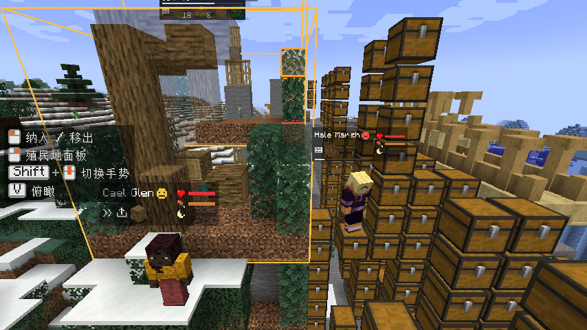

# 剑与王国建筑包 → Folkways 转换包

## 内容

- 24 个建筑包，共 **7368 个可加载 NBT 建筑**
- 13,964,464 个方块，其中 Do 材质方块 1,218,111 个
- 带 `textureData` 的 Do 方块 1,129,482 个
- 中文名称表 `blueprint_names_zh_cn.json`
- 已打 **精确 Do 预览 + 中文名称显示** 补丁的 `folkways-vanilla` jar
- `collections/tested_1304/`：已实机验证可加载的 4 包（1304 个建筑）

## 安装

1. 备份原 `mods/folkways-vanilla-neoforge-1.21.1-0.1.0-nightly.86e1068.jar`。
2. 用本包 `mods/` 里的两个 jar 覆盖/放入实例 `mods/`。
3. 把想安装的 `packs/<包名>` 复制到：
   `folkways/blueprint/<包名>`
4. 把 `blueprint_names_zh_cn.json` 复制到：
   `config/folkways_ornamentum/blueprint_names_zh_cn.json`
5. 重启游戏。

## 加载优化：现在可以一次安装全部包

分享包里的 `folkways-vanilla` 已经打了**本地蓝图惰性加载**补丁：

- 启动时只索引 `folkways/blueprint` 下的文件名和路径，不再把所有 NBT 读进内存；
- 蓝图选择器真正选中/预览某一栋时，才读取对应的一个 NBT；
- 因此 24 个包 / 7368 个建筑可以一次性安装，启动实测正常进入世界并完成自检；
- 启动日志只显示 `1 piece(s) loaded`，这是正常的：本地 7368 个蓝图按需读取；
- 本地 NBT 读取上限从 8 MB 提升到 **64 MB**，选中大型扫描件不再误报
  “这个文件不是可建造的结构”；
- 已对全部 7368 个本地蓝图做逐项检查：`seen=7368 missing=0 invalid=0`
  （选中时读取和 `StructureNbt` 解析都成功）。

旧的“全部安装会 OOM”和“选中报不是可建造结构”问题只会在使用旧版
`folkways-vanilla` 时出现。请务必使用本包 `mods/` 里的核心 jar。

如果只想快速验证，仍可使用：

```text
collections/tested_1304/
  high_elven
  age_of_colonies
  cqs_extras
  road
```

## 跳过 877 个文件

转换器跳过：

1. 过滤掉 `minecolonies:` / `structurize:` 方块后为空的“纯升级/功能占位”文件；
2. 解压 NBT 超过 Folkways 8 MB 读取上限的超大扫描件。

跳过清单在 `conversion_manifest.json` 的 `skipped` 字段。

## Do 汉化

包内已经包含在剑与王国中使用的 Domum Ornamentum 简体中文翻译：

- 来源：剑与王国整合包内的
  `Minecraft-Mod-Language-Modpack-Converted-1.20.1.zip`
- `mods/folkways_ornamentum-1.0.0.jar` 内嵌：
  `assets/domum_ornamentum/lang/zh_cn.json`
  （218 个键，补齐了 1.20.1 语言包缺失的 1.21.1 格式键）
- 也可作为资源包单独启用：
  `Do-汉化资源包.zip`

安装本包后，在游戏语言为简体中文时，Do 方块/物品和建筑师切割机的名称会显示中文；
不需要再额外安装 `Minecraft-Mod-Language-Modpack-Converted-1.20.1.zip`。

## 地面方块选择

转换时，`structurize:blocksolidsubstitution` 占位格不再自动选“随机/每栋最接近”的方块，
而是统一使用 `ground_blocks.json` 的选择：

- 默认：`minecraft:stone_bricks`（石砖）
- `default`：全局默认；
- `packs`：按包覆盖，例如 `"high_elven": "minecraft:calcite"`；
- `buildings`：按单栋覆盖，例如
  `"high_elven/education/university5": "minecraft:quartz_block"`。

修改后运行：

```bash
python choose_ground.py
# 或直接编辑 ground_blocks.json 后运行：
python convert_sword_blueprints.py
```

`choose_ground.py` 提供石砖、方解石、平滑石英、深板岩砖、磨制闪长岩、石头和自定义
block id 的快捷选择，并可直接重新转换全部包。

本次交付的 7368 个 NBT 已按默认 **石砖** 重新转换。

## 名称汉化

- 包名：24 个包全部有中文显示名。
- 建筑名：约 72% 完全中文化，其余主要是 `f`、`x`、UUID 之类的匿名本地扫描件，
  显示为“本地扫描 xxx”；可在 `blueprint_names_zh_cn.json` 里直接改。
- 中文名只影响 UI 显示，NBT 文件名仍是 ASCII，避免 ResourceLocation 拒绝中文路径。

## 实机验证

除启动检查外，还直接用转换后的本地蓝图走了一遍完整的原生下单→工地→放置流程：

```text
文件：age_of_colonies/agriculture_fields/3vines.nbt
SELFTEST-PASS wanted=78 placed=78
verifyMismatch=0 elapsed=1200t
```

同时用蓝图选择器的同一 `take` 路径选中该蓝图，日志：

```text
TEST-HOLD id=local:blueprint/age_of_colonies/agriculture_fields/3vines bytes=27934
TEST-HOLD-RESULT part=3vines held=true
```

截图：

- 选中后的幽灵放置预览：
  [evidence/converted-3vines-ghost-2026-11-13.png](evidence/converted-3vines-ghost-2026-11-13.png)
- 已生成工地并施工中的截图：
  [evidence/converted-3vines-build-2026-11-13.png](evidence/converted-3vines-build-2026-11-13.png)

## 放置阶段错误修复

除了 8 MB 读取上限，放置阶段还有第二个根因：

- 本地蓝图上传时原本发送**中文显示名**（例如 `3·藤蔓`）；
- 服务端 `LibraryPath.of(packet.name())` 只接受 ASCII 存档名，中文/间隔号导致 name 为空；
- 服务端因此跳过 `readStructure`，直接按空文件处理并显示
  “这个文件不是可建造的结构”。

现在上传包发送 ASCII 文件名（例如 `3vines`），UI 仍显示中文名。实机日志：

```text
UPLOAD-TEST-SENT ... bytes=551
UPLOAD-RECEIVE player=dragon name=3vines direct=true bytes=551
```

服务端不再出现 `UPLOAD-EMPTY`，并成功生成第二个工地。



## Materials Integration 兼容

分享包已加入 `materials_integration-2.8.jar` 和对应桥接：

- **Do 方块挖掘掉落资源**：读取 Do 方块实体的 `textureData`，按主材质映射为
  `planks_integration` / `log_integration` / `rock_integration` /
  `stone_integration` / `sand_integration` / `dirt_integration`；
- **分拣台接入 Folkways**：`materials_integration:sorting_workbench` 作为殖民地工作站，
  `SorterWorkshop` 会向规划器提供“用资源分拣出实际建材”的选项；
- **资源用于生产**：`SorterWork` 消耗对应资源并按配方产出目标物品，供建造工/切割机继续使用。

实机自检日志：

```text
MATERIALS-DO broken=true drops=1 items=[1 materials_integration:planks_integration]
MATERIALS-SORTER at=... options=1
MATERIALS-SORTER-CLAIM claim=... claims=1
MATERIALS-SORT-COMMIT outcome=Done made=[8 minecraft:oak_planks]
```

## 注意

- 中文显示需要本包内打过补丁的 `folkways-vanilla` jar；只放 NBT 不会显示中文名。
- 依赖：Folkways core nightly 86e1068、Domum Ornamentum 1.0.237、Create 1.21.1。
- 转换自 `剑与王国官服正式版/blueprints`，保留原作者与包名信息在 manifest 中。
